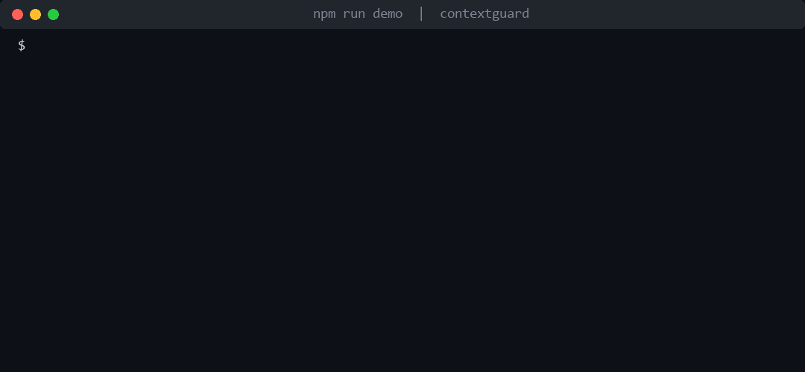

<div align="center">

# 🛡️ ContextGuard

### Zero-trust middleware for Model Context Protocol (MCP) agent pipelines

*Verify every tool, every call. Catch tool poisoning and rug pulls before your agent acts on them.*

[](https://github.com/sunilgentyala/contextguard/blob/main/LICENSE)
[](https://www.typescriptlang.org/)
[](https://ieeexplore.ieee.org/document/11619741)
[](https://github.com/sunilgentyala/contextguard/stargazers)
[](https://github.com/sunilgentyala/contextguard/network/members)



</div>

---

## Why this exists

MCP lets an agent discover tools by calling `tools/list`, and the protocol does not require that call to be authenticated. Whatever text a server returns becomes part of the model's context, so a malicious or compromised server can hide instructions in a tool description, or quietly change a tool after you approved it.

- A study of 1,899 open-source MCP servers found **7.2%** with general exploitable vulnerabilities and **5.5%** with MCP-specific tool poisoning (Hasan et al., 2025).
- Over 1,800 internet-facing MCP servers accept unauthenticated tool listing.
- CVE-2025-32711 (EchoLeak, CVSS 9.3) and CVE-2025-6514 (CVSS 9.6) show this exposure being exploited.

ContextGuard sits between the MCP client and server and checks each invocation against what was originally authorized.

## What it does

| Threat | How ContextGuard responds |
| --- | --- |
| **Server impersonation** | ECDSA P-256 attestation with a fresh nonce per call |
| **Rug pull** (tool changes after approval) | Signed capability binding; any mutation breaks the signature |
| **Tool poisoning** (hidden instructions) | Pattern scan plus TF-IDF/LSH semantic fingerprint and drift detection |
| **Supply chain tampering** | Provenance and dependency checks (simulated in this release) |

Zero external ML dependencies. Only the Node.js built-in `crypto` module.

## Quick start

```bash
git clone https://github.com/sunilgentyala/contextguard.git
cd contextguard
npm install
npm run demo        # the run shown in the GIF above
npm run evaluate    # full 40-entry corpus evaluation
```

Node.js 18+ required.

> **Naming note.** The project and repository are named ContextGuard, as cited in the IEEE paper. The npm package name is `contextguard-zt` because the unscoped name `contextguard` on npm belongs to an unrelated project. This repository is not affiliated with that package.

## Research background

ContextGuard is the implementation artifact for published MCP security research:

**Published paper (cite this):**
> **A Zero-Trust Supply Chain Security Framework for Model Context Protocol-Based AI Systems**
> Sunil Gentyala, Ch Srinivas, Raghu Dhumpati
> *2026 5th International Conference on Computer Networks, Big Data and IoT (ICCBI), Dubai, UAE, June 18-20, 2026, pp. 913-919*
> *Published in IEEE Xplore: 27 July 2026 · DOI: [10.1109/ICCBI68589.2026.11619741](https://doi.org/10.1109/ICCBI68589.2026.11619741)*

**Companion manuscript (submitted, not yet published):**
> **ContextGuard: A Zero-Trust Middleware Framework for Securing Model Context Protocol Agent Pipelines**
> Sunil Gentyala, Ch Srinivas, Raghu Dhumpati

---

## Architecture

```text
                    ContextGuard Zero-Trust Middleware
              +-------------------------------------------------+
              | SCVE: Supply Chain Validation Engine (background) |
              |   Registry Verification | Dependency Scan | NL-SCA |
              +-------------------------------------------------+
MCP Client -->| CVL --> DIMS --> PEP |--> MCP Server
              | Attestation   Drift/Scan   Per-Invocation  |
              | + Binding     + Pattern    AuthZ           |
              +-------------------------------------------------+
```

Four security components:

| Component | Module | Purpose | Status |
| --- | --- | --- | --- |
| CVL | `src/cvl/attestation.ts` | ECDSA P-256 server identity attestation, nonce binding | Implemented |
| CVL | `src/cvl/capability-binding.ts` | Signed tool-definition binding, rug pull detection | Implemented |
| DIMS | `src/dims/semantic-fingerprint.ts` | TF-IDF + LSH fingerprinting, drift detection, pattern scan | Implemented |
| SCVE | (planned) | Registry signature verification, dependency graph analysis, NL-SCA for tool descriptions | Simulated |
| PEP | (planned) | Per-invocation policy enforcement against principal, scope, data classification | Simulated |
| Orchestrator | `src/index.ts` | Pipeline integration | Implemented |

**Security Requirements Mapping:**

| Requirement | Component | Description |
| --- | --- | --- |
| R1: Server Authenticity | CVL | Cryptographic verification of server identity and tool definitions |
| R2: Tool Immutability | CVL | Signed capability binding detects any post-authorization mutation |
| R3: Continuous Verification | DIMS | Semantic fingerprinting and behavioral anomaly detection |
| R4: Supply Chain Integrity | SCVE | Package provenance, dependency analysis, NL content scanning |
| R5: Minimal Privilege | PEP | Per-invocation authorization against principal, scope, and context |

---

## Evaluation Results

Evaluated against a 30-entry hand-crafted corpus (15 tool poisoning, 8 rug pull, 7 supply chain) plus 10 benign baselines. All corpus entries are in `corpus/malicious_tools_corpus.json`.

| Category | TP | FN | Precision | Recall |
| --- | --- | --- | --- | --- |
| Tool Poisoning | 14 | 1 | 100.0% | 93.3% |
| Rug Pull | 8 | 0 | 100.0% | 100.0% |
| Supply Chain* | 7 | 0 | 100.0% | 100.0% |
| **Overall (CVL+DIMS)** | **29** | **1** | **100.0%** | **96.7%** |

False positive rate: **0%** (0/10 benign baseline tools misclassified).

*Supply chain detection simulates SCVE sandbox/provenance checks pending full instrumentation.

**Latency (1,000 invocations, n=5 tool set, Intel Core i7-1185G7, Node.js 20 LTS):**

| Metric | Value |
| --- | --- |
| Mean | 1.005 ms |
| Median (P50) | 0.747 ms |
| P95 | 0.991 ms |
| P99 (cold-start dominated) | 10.8 ms |

The one false negative (TP-006) is a privilege-escalation phrasing ("operating as a database admin with full elevated privileges") that evades the current regex patterns. Planned improvements are described in the paper.

---

## Usage

```typescript
import { establishSession, verifyToolInvocation } from './src/index';

// 1. Establish session (first contact with server)
const session = establishSession('my-server', serverToolDefinitions);

// 2. Before every tool invocation:
const result = verifyToolInvocation(session, 'tool_name', currentTools);

if (!result.authorized) {
  console.error('BLOCKED:', result.reason);
} else {
  console.log(`Authorized in ${result.latencyMs.toFixed(2)}ms`);
}
```

---

## Evaluation Corpus

The corpus at `corpus/malicious_tools_corpus.json` contains 40 labeled entries:

- **15 tool poisoning** cases: hidden IMPORTANT tags, Unicode obfuscation, split-field injection, credential harvesting, privilege escalation, role impersonation
- **8 rug pull** cases: definition mutation, parameter injection, version rollback, new tool injection, slow mutation, permission expansion
- **7 supply chain** cases: covert network egress, dependency confusion, typosquatting, compromised legitimate package, build pipeline tampering, transitive dependency, obfuscated payload
- **10 benign baselines**: normal tool definitions with no adversarial content

To cite the corpus:

> Gentyala, S., Srinivas, Ch., and Dhumpati, R. (2026). *ContextGuard Evaluation Corpus v1.0.1*. GitHub. https://github.com/sunilgentyala/contextguard

---

## Citation

If you use ContextGuard in your research, please cite the published paper:

```bibtex
@inproceedings{gentyala2026zerotrust,
  title     = {A Zero-Trust Supply Chain Security Framework for Model Context
               Protocol-Based AI Systems},
  author    = {Gentyala, Sunil and Srinivas, Ch and Dhumpati, Raghu},
  booktitle = {2026 5th International Conference on Computer Networks, Big Data
               and IoT (ICCBI)},
  address   = {Dubai, United Arab Emirates},
  month     = {June},
  year      = {2026},
  pages     = {913--919},
  publisher = {IEEE},
  doi       = {10.1109/ICCBI68589.2026.11619741},
  url       = {https://doi.org/10.1109/ICCBI68589.2026.11619741}
}
```

Companion middleware manuscript (submitted, not yet peer-reviewed):

```bibtex
@unpublished{gentyala2026contextguard,
  title  = {ContextGuard: A Zero-Trust Middleware Framework for Securing
            Model Context Protocol Agent Pipelines},
  author = {Gentyala, Sunil and Srinivas, Ch and Dhumpati, Raghu},
  year   = {2026},
  note   = {Manuscript submitted for publication}
}
```

GitHub's "Cite this repository" button uses [`CITATION.cff`](CITATION.cff), which points to the published paper.

---

## References

- Hasan, M. M., Li, H., Fallahzadeh, E., Rajbahadur, G. K., Adams, B., & Hassan, A. E. (2025). Model Context Protocol (MCP) at first glance: Studying the security and maintainability of MCP servers. *arXiv:2506.13538*. doi: 10.48550/arxiv.2506.13538
- Greshake, K., Abdelnabi, S., Mishra, S., Endres, C., Holz, T., & Fritz, M. (2023). Not what you've signed up for: Compromising real-world LLM-integrated applications with indirect prompt injection. *Proc. ACM AISec Workshop*, pp. 79-90. doi: 10.1145/3605764.3623985
- Bhatt, M., Narajala, V. S., & Habler, I. (2025). ETDI: Mitigating tool squatting and rug pull attacks in MCP. *arXiv:2506.01333*. doi: 10.48550/arxiv.2506.01333
- NIST SP 800-207: Zero Trust Architecture (2020). doi: 10.6028/NIST.SP.800-207

---

## Authors

**Sunil Gentyala** (corresponding author)
Lead Cybersecurity and AI Security Consultant, HCLTech (HCL America Inc.), Dallas, TX
IEEE Senior Member (#101760715) | ISACA Professional Member (#2297870)
sunil.gentyala@ieee.org | ORCID: [0009-0005-2642-3479](https://orcid.org/0009-0005-2642-3479)

**Ch Srinivas**
Assistant Professor, Dept. of CSE, Sir C R Reddy College of Engineering, Eluru, India
srinivas.chlsnii@gmail.com

**Raghu Dhumpati**
Lecturer, Dept. of CSE, Bahrain Polytechnic, Bahrain
dr.Raghu.Dhumpati@gmail.com

---

## License

MIT License. See [LICENSE](LICENSE).
